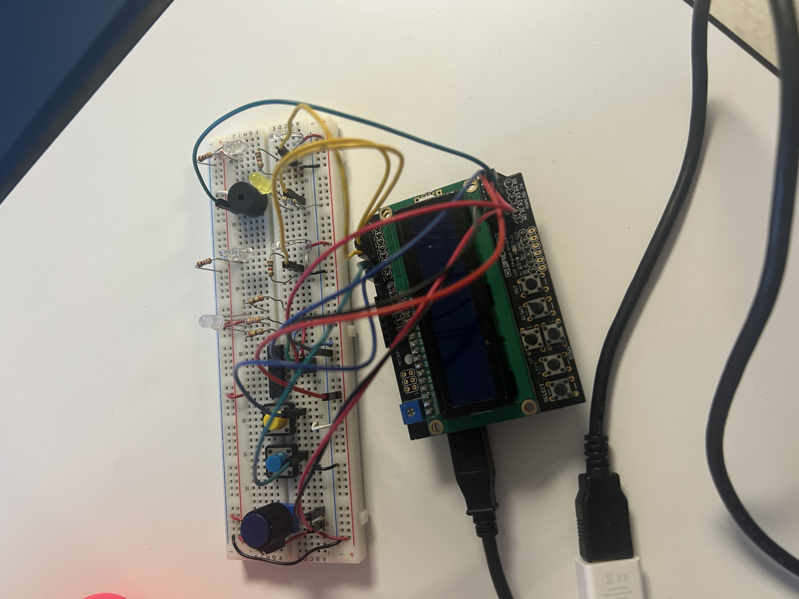

# 🚦 Speed Trap — Embedded Speed Detection System

> A real-time speed measurement system written in bare-metal C for the ATmega328P (Arduino Uno). I built it as the final project for **EE 109: Introduction to Embedded Systems** at USC in Fall 2025.

---

## 📌 Overview

When an object passes between two phototransistor sensors, the Speed Trap measures how long it took and calculates its speed to a hundredth of a cm/s. It shows the result on an LCD and points a servo-driven dial at the speed. If the object is outside a speed range the user sets, it warns them with an RGB LED and a buzzer.

Everything is written **without Arduino libraries**. The code configures the AVR's timers, pin-change interrupts, PWM and EEPROM directly through hardware registers.

> 🔒 **Source code is available on request.** It isn't posted publicly because of course policy, so future EE 109 students can't copy it.

## ✨ Features

- **Interrupt-driven timing:** The start and stop sensors trigger pin-change interrupts. Timer1 runs with a /1024 prescaler, so each tick is 64 µs.
- **Integer-only speed math:** Speed and elapsed time are calculated with scaled 32-bit integer arithmetic, so the 8-bit MCU never needs floating-point code.
- **Timeout detection:** If the second sensor isn't triggered within 4 seconds, a hardware compare-match interrupt cancels the measurement and the LCD shows a timeout message.
- **Adjustable speed range:** Two buttons choose whether you're editing the low or high limit. A rotary encoder then changes that limit anywhere from 1 to 99 cm/s, and the low limit can never go above the high limit.
- **Gray-code encoder decoding:** A 4-state machine inside the interrupt handler reads the rotation direction reliably.
- **Saved settings:** Both limits are stored in EEPROM, so they stay the same after a power cycle. When the board starts up, it checks that the saved values are valid before using them.
- **Status LEDs:** A yellow LED stays on while a measurement is being timed. An RGB LED turns **red** when the object is too fast and **blue** when it's too slow.
- **Buzzer alarm:** If **3 readings in a row** are out of range, the buzzer plays a two-tone warning. The tones are generated by a timer interrupt, so the main loop is never blocked.
- **Servo speed gauge:** A servo driven by PWM moves a needle to match the measured speed, like an analog speedometer.

## 🛠️ Hardware

| Component | Purpose |
|---|---|
| Arduino Uno (ATmega328P @ 16 MHz) | Microcontroller |
| 16×2 LCD shield | Display |
| 2× phototransistor + white LED | Start and stop sensors |
| 2× pushbuttons | Choose which limit to edit |
| Rotary encoder | Adjusts the speed limits |
| Yellow LED | Timing indicator |
| RGB LED | Too fast or too slow indicator |
| Buzzer | Audio warning |
| Servo motor | Analog speed gauge |
| SN74HCT00N NAND gate | Signal conditioning |

### 🔧 Build in Progress

*Wiring and testing the sensors and peripherals on the breadboard.*

**Estimated cost:** about **$47.91 per unit** for a 1,000-unit production run, not counting the PCB.

## ⚙️ How It Works

1. The first sensor triggers an interrupt that resets and starts a hardware timer and turns on the timing LED.
2. The second sensor stops the timer. The elapsed ticks are converted to milliseconds and cm/s using integer math only.
3. If 4 seconds pass before the second sensor triggers, a timer interrupt cancels the measurement.
4. The interrupt handlers do only the time-critical work and then set flags. The main loop handles the slower work: LCD updates, servo movement, limit checks, EEPROM writes and the buzzer sequence.

## 🧠 What I Learned

- Controlling AVR peripherals directly through their registers
- Keeping ISRs short and handing work off to the main loop with `volatile` flags
- Setting up one MCU's three timers for three different jobs: measurement, tone generation and PWM
- Doing fixed-point arithmetic on an 8-bit microcontroller without floats
- Decoding a quadrature encoder and debouncing mechanical inputs
- Storing settings in EEPROM without wearing it out

## 👤 Author

**Daisy Fregoso** · [LinkedIn](#) <!-- replace # with your LinkedIn URL -->

*Built for EE 109 at the University of Southern California, Fall 2025.*
